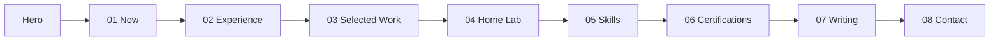
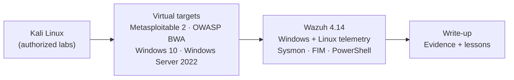

<div align="center">

# Muhammad Zaid — Security Portfolio

**Learning security from both sides: investigate, build, break (in labs), document.**

[](https://muhammad-zaid-portfolio-one.vercel.app/)
[](https://muhammadzaid2009-sudo.github.io/Portfolio/)
[](#roadmap)


[**View Live Site**](https://muhammad-zaid-portfolio-one.vercel.app/) ·
[**Contact**](mailto:muhammadzaid2009@outlook.com) ·
[**GitHub**](https://github.com/muhammadzaid2009-sudo) ·
[**LinkedIn**](https://www.linkedin.com/in/muhammad-zaid2009/)

</div>

---

## Table of Contents

- [Overview](#overview)
- [Site Sections](#site-sections)
- [Design System](#design-system)
- [Tech Stack](#tech-stack)
- [Architecture & Content Model](#architecture--content-model)
- [Project Structure](#project-structure)
- [Getting Started](#getting-started)
- [Deployment](#deployment)
- [SEO & Social Sharing](#seo--social-sharing)
- [Accessibility](#accessibility)
- [Privacy & Responsible Disclosure](#privacy--responsible-disclosure)
- [Roadmap](#roadmap)
- [Connect](#connect)
- [License](#license)

---

## Overview

This repository contains the source of my personal portfolio: a single-page, evidence-first site that presents my work as a **first-year computer science student specializing in cybersecurity**.

The site is built around one idea: *I break things in labs so I can learn to detect and defend them in the real world.* Every section is written to show **method and evidence** (what I did, what I found, what I learned) rather than a list of buzzwords.

| | |
|---|---|
| **Owner** | Muhammad Zaid, Pakistan |
| **Focus** | SOC investigation, web application security, authorized labs, Python/Bash automation |
| **Current role** | SOC L1 Intern (Wazuh SIEM) |
| **Type** | Static, single-page portfolio |
| **Live URL** | <https://muhammad-zaid-portfolio-one.vercel.app/> |

---

## Site Sections

The page is a single scrolling document with a sticky anchor navigation and numbered section labels (`01 / Now` → `08 / Contact`).

| # | Section | What it shows |
|---|---------|---------------|
| — | **Hero** | Positioning statement, short bio, calls to action, and a *synthetic* Wazuh event-summary card (clearly labeled as sample data) |
| 01 | **Now** | Four active learning tracks: Blue team (SOC internship), Offensive security (authorized labs), Scripting (practical tools), Systems (foundations) |
| 02 | **Experience** | SOC L1 Intern work, described at a high level with Wazuh, Apache, and web-server log triage |
| 03 | **Selected Work** | Write-Ups, Scripts & Tools, CTF/Lab docs (GitBook), Python Projects, and Medium articles, each with a "why it exists" note |
| 04 | **Home Lab** | VMware lab diagram: Kali attacker → four vulnerable targets → Wazuh 4.14 telemetry → write-ups |
| 05 | **Skills** | Three tiers: *Hands-on*, *Learning now*, *Planned next* |
| 06 | **Certifications** | TryHackMe Jr Penetration Tester, TryHackMe Pre Security (Legacy), LetsDefend SOC Member badge |
| 07 | **Writing** | Links to GitHub write-ups, GitBook lab docs, and Medium |
| 08 | **Contact** | Email and all professional profiles |

---

## Design System

A calm, editorial look built to feel professional rather than flashy. The content does the talking.

### Principles

- **Evidence over decoration.** Concrete facts (labs completed, modules, dates) instead of vague skill bars.
- **Honest labeling.** Sample data, project maturity, and unverified items are explicitly marked.
- **Readable first.** Strong typographic hierarchy, generous whitespace, short paragraphs.
- **Editorial rhythm.** Numbered section eyebrows (`01 / Now`) and italic emphasis in headlines (for example, *both sides.*).

### Visual language

| Element | Choice |
|---------|--------|
| **Theme** | Light, cool-gray surface (`theme-color: #e8edf1`) |
| **Layout** | Single column flow with card grids for projects, tracks, and certifications |
| **Navigation** | Sticky anchor nav with a skip-to-content link and `MZ.` wordmark |
| **Status chips** | `In progress`, `Building`, `Learning`, `Experimental`, `Authorized labs` |
| **Data card** | Wazuh-style event summary in the hero (explicitly marked *Synthetic interface sample*) |
| **Diagram** | Custom inline SVG for the home lab workflow, with a full text alternative |
| **Badges** | Real certification and badge artwork embedded where available |

---

## Tech Stack

> This is a **static, dependency-light** site. No server, no database, no build pipeline required to run it.

| Layer | Technology | Purpose |
|-------|-----------|---------|
| **Markup** | HTML5 (semantic) | Document structure, landmarks, anchors |
| **Styling** | CSS3 | Layout, theming, responsive design |
| **Behavior** | Vanilla JavaScript | Lightweight interactivity |
| **Graphics** | Inline SVG | Home lab diagram, Open Graph card |
| **Hosting** | Vercel | Primary production deployment |
| **Mirror** | GitHub Pages | Canonical URL target |
| **Version control** | Git & GitHub | Source and history |

<!-- VERIFY: confirm whether any JS is used and whether any CSS framework or font library is loaded. Update the table above if so. -->

---

## Architecture & Content Model

The site is a single `index.html` entry point with section anchors. Content is organized as repeating components:



### Home lab workflow (as shown on the site)



> The lab runs in isolated VMware environments on a Windows 11 host. **No employer systems or data are involved.**

---

## Project Structure

<!-- VERIFY: replace with the real tree from your repo (run `tree -L 2` locally). -->

```text
Portfolio/
├── index.html          # Single-page site
├── assets/
│   ├── og-card.svg                  # Open Graph / Twitter preview image
│   └── letsdefend-soc-member.png    # LetsDefend SOC Member badge
└── README.md
```

---

## Getting Started

### Prerequisites

- A modern browser
- *(Optional)* Python 3 or Node.js for a local static server

### Run locally

```bash
# 1. Clone the repository
git clone https://github.com/muhammadzaid2009-sudo/Portfolio.git
cd Portfolio

# 2a. Open directly
#     Double-click index.html

# 2b. Or serve it (recommended, so root-relative asset paths behave like production)
python -m http.server 8000
# then visit http://localhost:8000
```

### Customize

| To change | Edit |
|-----------|------|
| Bio, headline, tracks | `index.html` → Hero and `01 / Now` |
| Projects | `index.html` → `03 / Selected work` |
| Certifications | `index.html` → `06 / Certifications` and `assets/` |
| Meta tags / social card | `<head>` in `index.html` and `assets/og-card.svg` |

---

## Deployment

The site is a static bundle, so it deploys anywhere.

**Vercel (production)**

1. Import the repository in Vercel
2. Framework preset: **Other**, with no build command and the root directory as output
3. Every push to `main` redeploys automatically

**GitHub Pages (mirror / canonical)**

1. Repo → **Settings → Pages**
2. Source: `main` branch, `/ (root)`
3. Live at `https://muhammadzaid2009-sudo.github.io/Portfolio/`

---

## SEO & Social Sharing

| Feature | Implementation |
|---------|----------------|
| **Title** | `Muhammad Zaid — Security portfolio` |
| **Meta description** | CS student focused on cybersecurity, SOC investigation, web app security, and hands-on labs |
| **Canonical URL** | `https://muhammadzaid2009-sudo.github.io/Portfolio/` |
| **Open Graph** | `og:title`, `og:description`, `og:type=website`, `og:image` |
| **Twitter Card** | `summary_large_image` with title, description, and image |
| **Social image** | `assets/og-card.svg` |
| **Viewport** | `width=device-width, initial-scale=1` for mobile |
| **Theme color** | `#e8edf1` |

---

## Accessibility

- **Skip to content** link at the top of the page
- **Semantic landmarks** and in-page anchor navigation
- **Text alternative** for the home lab SVG diagram
- **Alt text** on badge imagery
- Clear heading hierarchy and descriptive link text

---

## Privacy & Responsible Disclosure

This portfolio is deliberately conservative about what it shows:

- Professional work is described **at a high level only**. No client names, internal systems, or employer telemetry.
- The hero Wazuh card is **synthetic sample data**.
- All offensive security work is performed in **authorized, isolated lab environments**.
- Tools linked from the portfolio are **early experiments**, intended for isolated, authorized environments only.

---

## Roadmap

- [x] Redesigned single-page portfolio
- [x] Home lab diagram with text alternative
- [x] Certifications section with verifiable links
- [ ] Resolve placeholder labels (skills depth confirmation, featured Python project)
- [ ] Add dated Medium article list
- [ ] Add a dedicated case study for a Wazuh investigation (sanitized)
- [ ] Add per-project detail pages or write-up previews
- [ ] Add Active Directory attack and defense lab write-ups

---

## Connect

| Platform | Link |
|----------|------|
| Email | [muhammadzaid2009@outlook.com](mailto:muhammadzaid2009@outlook.com) |
| LinkedIn | [muhammad-zaid2009](https://www.linkedin.com/in/muhammad-zaid2009/) |
| GitHub | [muhammadzaid2009-sudo](https://github.com/muhammadzaid2009-sudo) |
| TryHackMe | [muhammadzaid2009](https://tryhackme.com/p/muhammadzaid2009) |
| GitBook | [CTF & Lab Docs](https://muhammad-zaid.gitbook.io/muhammad-zaid-ctf-docs/) |
| Medium | [@muhammadzaid2009](https://medium.com/@muhammadzaid2009) |

---

## License

<!-- VERIFY: add a LICENSE file and update this line. -->
© Muhammad Zaid. All rights reserved. Please do not copy personal content, certifications, or branding. Feel free to take inspiration from the structure and layout.

<div align="center">

*Built while learning. Updated as I learn more.*

</div>
